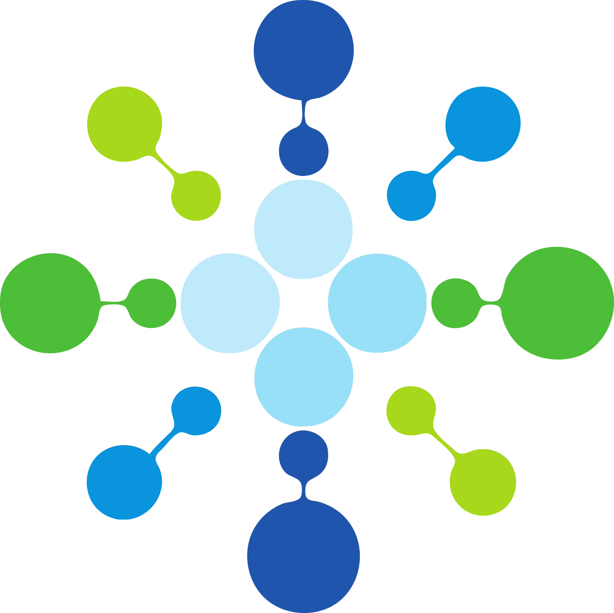

---
---
<!--This line is commented-->

The Nano]°[Biostructures Research Group is part of Experimental and Molecular Medicine Unit at the Institute for Obesity Research, Tecnologico de Monterrey. Our research group combines computational chemistry, cheminformatics, molecular modeling, and scientific software development to investigate therapeutic targets and bioactive compounds relevant to metabolic regulation, mitochondrial function, obesity, and related disorders. 

This portfolio presents our scientific software and related projects, including open-source tools developed to support reproducible and traceable molecular research. We also participate in pyOpenSci's community-led software peer-review process through package submission and editorial service.

Our logo reflects molecular organization and connectivity within chemical space.

 

## Python Packages

| Name | Description | Resources |
|---|---|---|
|  **[CHAMANP](https://nanobiostructuresrg.github.io/chamanp/)** | Natural Product Molecular Annotation and Curation Toolkit | [PyPI](https://pypi.org/project/chamanp/) · [Zenodo](https://zenodo.org/records/20337903) |
|  **[HARMONSMILE](https://nanobiostructuresrg.github.io/harmonsmile/)** | Molecular Structure Harmonizer | [PyPI](https://pypi.org/project/harmonsmile/) · [Zenodo](https://zenodo.org/records/20330338) |
|  **[HDDFLYZER](https://nanobiostructuresrg.github.io/hddflyzer/)** | High-Dimensional Descriptor-Based Feature Space Analyzer | [PyPI](https://pypi.org/project/hddflyzer/) · [Zenodo](https://zenodo.org/records/20707295) |
|  **[MELITE](https://nanobiostructuresrg.github.io/melite/)** | Multi-Model Supervised Learning Evaluator | [PyPI](https://pypi.org/project/melite/) · [Zenodo](https://zenodo.org/records/20382752) |
|  **[MOLRAPTOR](https://nanobiostructuresrg.github.io/molraptor/)** | Molecular Fingerprint Rapid Generator | [PyPI](https://pypi.org/project/molraptor/) · [Zenodo](https://zenodo.org/records/20434420) |

 

## Local Application

| Name | Description | Resources |
|---|---|---|
|  **[ChemVault](https://nanobiostructuresrg-lab.github.io/chemvault/)** | Target-Centered Bioactivity Dataset Construction | [PyPI](https://pypi.org/project/ChemVault/) · [Zenodo](https://zenodo.org/records/23378449) |

 

## Online Services
- **[LigandHub](https://nanobiostructuresrg.github.io/LigandHub/)** — Cheminformatics Workflow Platform (under development).

 

## Tutorials
- **[AutoDock](https://nanobiostructuresrg.github.io/AutodockTutorial/)** — An introductory tutorial to AutoDock Vina covering the basics of molecular docking and result analysis.
- **[ChemInformatics](https://nanobiostructuresrg.github.io/CheminformaticsTutorial/)** — An introductory tutorial to Cheminformatics tools with excercises.
- **[NumPy](https://nanobiostructuresrg.github.io/NumpyTutorial/)** — An introductory tutorial to NumPy covering linear algebra, testing, and debugging code in Python.

---
### Profiles & Links
[Website](https://sites.google.com/tec.mx/nanobiostructures)  |  [ORCiD](https://orcid.org/0000-0003-2375-131X)  |  [GoogleScholar](https://scholar.google.com/citations?user=vV2vSG8AAAAJ&hl=es&oi=sra)  |  [GitHub](https://github.com/NanoBiostructuresRG)  |  [Bluesky](https://bsky.app/profile/flaviocontreras.link)  |  [Gravatar](https://flaviocontreras.link/)

